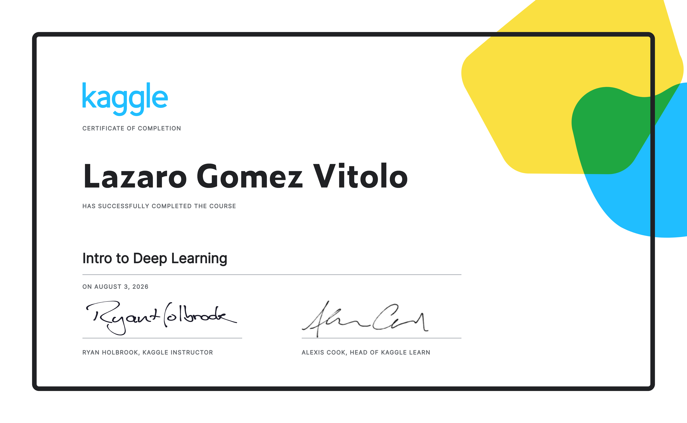
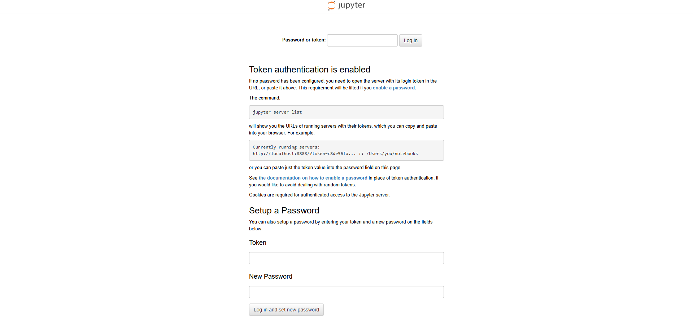

# Intro to Deep Learning — TensorFlow & Keras on Structured Data

[](https://github.com/Lazaro549/intro-deep-learning-starter/actions/workflows/ci.yml)




A hands-on companion to Kaggle Learn's **[Intro to Deep Learning](https://www.kaggle.com/learn/intro-to-deep-learning)**
course (instructor: Ryan Holbrook), rebuilding all six lessons with `tf.keras` on real structured/tabular data
instead of just reading along.

## What's here

[`notebooks/intro_to_deep_learning.ipynb`](notebooks/intro_to_deep_learning.ipynb) walks through the full course
syllabus end-to-end. It contains the code and explanations for all six lessons. To see the plots and results,
install the dependencies and run the notebook using the instructions below.

| # | Lesson | Demonstrates |
|---|---|---|
| 1 | A Single Neuron | `Dense(1)` as linear regression |
| 2 | Deep Neural Networks | Stacked `Dense` + `relu` layers |
| 3 | Stochastic Gradient Descent | Explicit optimizer / loss / batch size, loss curves |
| 4 | Overfitting and Underfitting | Watching a model overfit, then fixing it with `EarlyStopping` |
| 5 | Dropout and Batch Normalization | Regularizing an overparameterized network — with an honest look at when each technique actually helps |
| 6 | Binary Classification | `sigmoid` + `binary_crossentropy` + `binary_accuracy` |

Two structured datasets from scikit-learn power the notebook, both bundled with the library so nothing needs to be
downloaded:

- **Regression** — `load_diabetes` (442 patients, 10 baseline features, disease-progression target)
- **Binary classification** — `load_breast_cancer` (569 samples, 30 features, malignant/benign)

Lesson 5 is worth calling out: rather than assuming Dropout and BatchNormalization both help by default, the
notebook measures the train/validation gap for each and shows that BatchNorm's benefit is dataset-dependent — on
this small a dataset its mini-batch statistics stay noisy and it doesn't reliably help, while Dropout alone does.
That's the actual takeaway from the lesson, not just the API syntax.

## Getting started

```bash
git clone https://github.com/lazaro549/intro-deep-learning-starter.git
cd intro-deep-learning-starter
pip install -r requirements.txt
jupyter lab notebooks/intro_to_deep_learning.ipynb
```

If you'd rather use the classic Notebook interface: `jupyter notebook notebooks/intro_to_deep_learning.ipynb`
(needs the `notebook` package from requirements.txt — some environments don't pull it in just from
`pip install jupyter`).

### Reproducible environment

The project uses one pinned dependency set in [`requirements.txt`](requirements.txt) and **Python 3.12.3** as its single target interpreter. Both CI jobs use this exact Python version, matching the notebook metadata. Install the dependencies inside a virtual environment with:

```bash
python -m pip install -r requirements.txt
```

The pinned versions include TensorFlow 2.21.0, Keras 3.15.1, NumPy 2.1.3, pandas 3.0.2, scikit-learn 1.8.0, and Matplotlib 3.10.8. Notebook and test tools are pinned in the same file so local runs and CI use one dependency specification.

**Results provenance:** the currently committed `evaluation/results.json` is a historical artifact generated with Python 3.14.2, TensorFlow 2.22.0-rc0, and scikit-learn 1.9.1. These values intentionally remain unchanged until the evaluation is rerun; they are not results from the repository's standardized Python 3.12.3 environment. To regenerate the metrics and update their recorded environment, run `python -m evaluation.run_evaluation` after installing the pinned requirements.

## Repo structure

```text
.
├── .github/
│   └── workflows/
│       └── ci.yml
├── certificate/
│   └── kaggle-intro-to-deep-learning-certificate.png
├── evaluation/
│   ├── cross_validation.py
│   ├── held_out_test.py
│   ├── models.py
│   ├── run_evaluation.py
│   ├── evaluation_report.md
│   └── results.json
├── notebooks/
│   └── intro_to_deep_learning.ipynb
├── tests/
│   ├── test_data_preprocessing.py
│   ├── test_model_architecture.py
│   └── test_evaluation_metrics.py
├── requirements.txt
├── LICENSE
└── .gitignore
```
## Evaluation & Testing

The project includes automated evaluation and testing:

- **5-fold cross-validation** for regression and classification.
- **Shared TensorFlow/Keras architectures** across cross-validation and held-out evaluation.
- **Held-out test set** for final evaluation.
- **Automated tests** covering preprocessing, model architecture, metric ranges, end-to-end training/prediction for both tasks, input/output dimensions, and protection against fitting the scaler on held-out test data.
- **Notebook smoke test** executed automatically in CI.
- **GitHub Actions CI** validates tests and notebook execution.


### Latest model metrics

The table below is generated from actual model runs. To reproduce the results and refresh this table, run:

```bash
python -m evaluation.run_evaluation
```

<!-- EVALUATION-METRICS:START -->

### Regression — Diabetes dataset

| Metric | 5-fold CV (mean ± std) | Held-out test (n=89) |
|---|---:|---:|
| MAE | 48.8836 ± 4.2905 | 46.1653 |
| RMSE | 62.3458 ± 4.9176 | 61.1373 |
| R² | 0.3334 ± 0.1246 | 0.2711 |

### Binary classification — Breast Cancer dataset

| Metric | 5-fold CV (mean ± std) | Held-out test (n=114) |
|---|---:|---:|
| Accuracy | 0.9649 ± 0.0229 | 0.9649 |
| Precision | 0.9720 ± 0.0155 | 0.9595 |
| Recall | 0.9720 ± 0.0249 | 0.9861 |
| F1 | 0.9719 ± 0.0184 | 0.9726 |
| ROC-AUC | 0.9939 ± 0.0048 | 0.9917 |

_Generated: 2026-11-06 06:04:46 UTC · TensorFlow 2.22.0-rc0 · Python 3.14.2 · scikit-learn 1.9.1._

_Cross-validation values are mean ± standard deviation across five folds. Held-out metrics are from the independent 20% test split._

<!-- EVALUATION-METRICS:END -->

Run the tests locally:

    
    pytest -q
## Certificate

Kaggle "Intro to Deep Learning" — completed by Lazaro Gomez Vitolo, August 3, 2026. See
[`certificate/`](certificate/).

## 💸 Donations

If you'd like to support this project:

- 🇦🇷 ARS (Argentina)  
  Alias: `lazaro.503.alaba.mp`

- 🌎 USD (Argentina, local transfers only)  
  Alias: `ahogada.duras.foca`

## License

MIT — see [LICENSE](LICENSE).
